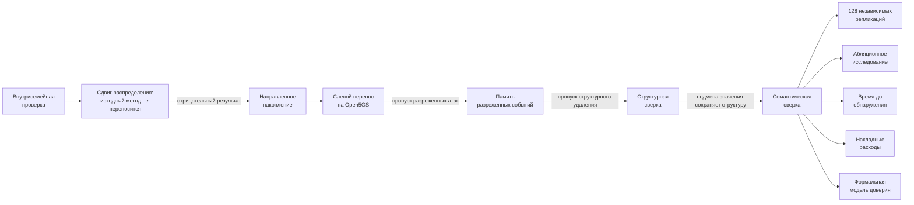

# Публикационная структура экспериментальной программы

Этот документ задаёт терминологию **для основной научной статьи**. В основном
тексте не используются внутренние номера этапов разработки. Они сохраняются
только в разделе воспроизводимости, где связывают публикационное описание с
конкретными ветками, фиксациями и артефактами репозитория.

## 1. Общая логика экспериментальной программы

Экспериментальная программа строится не как последовательность версий
программного обеспечения, а как последовательная проверка научных гипотез.

1. Проверить работоспособность исходного иерархического последовательного
   обнаружителя в пределах семейства генератора.
2. Проверить устойчивость вывода при сдвиге распределения и сравнении с
   классическими последовательными методами.
3. Проверить гипотезу о пользе сохранения направления рассогласования.
4. Проверить переносимость замороженного метода на реальный путь
   Open5GS SCP→NRF при слепом разделении телеметрии и меток.
5. Проверить обнаружение разреженных воздействий при помощи конечной памяти,
   включаемой только при устойчивой наблюдаемости.
6. Проверить структурные изменения, невидимые числовому каналу.
7. Проверить семантические подмены значений, сохраняющие структуру JSON.
8. Подтвердить итоговый эффект масштабной независимой репликацией.
9. Разложить итоговый эффект по каналам с помощью абляционного исследования.
10. Проверить вывод методами анализа времени до обнаружения.
11. Оценить вычислительную и сетевую стоимость метода.
12. Формально зафиксировать модель доверия и границы применимости.

В статье пункты 1–7 образуют **основную причинную последовательность
экспериментов**, а пункты 8–12 — **подтверждающие исследования**.

## 2. Научные названия основных экспериментов

### Эксперимент 1. Внутрисемейная проверка иерархического последовательного обнаружения

**Научный вопрос.** Улучшает ли иерархическое накопление статистических
свидетельств обнаружение атак по сравнению со статическими пороговыми
методами, если условия разработки и проверки принадлежат одному семейству
генератора?

**Содержание.** Синтетическая иерархическая модель, независимые контрольные
единицы, статические базовые методы и первоначальный последовательный
детектор на основе е-свидетельств.

**Основной результат.** Последовательный вариант улучшил полноту, задержку и
частоту ложных тревог относительно настроенного статического порога, однако
этот результат был получен в пределах того же семейства генератора.

**Роль в статье.** Не финальное доказательство качества, а исходная положительная
точка, необходимая для последующей проверки переносимости.

---

### Эксперимент 2. Проверка при сдвиге распределения и сравнение с классическими последовательными методами

**Научный вопрос.** Сохраняется ли преимущество исходного последовательного
детектора, если семейства атак, шум, дрейф и граничные условия отличаются от
условий разработки?

**Содержание.** Независимый генератор со сдвигом распределения, новые семейства
атак и сравнение с методами Page–Hinkley, CUSUM, EWMA и статическим
пороговым контролем.

**Основной результат.** Исходный детектор потерял преимущество; Page–Hinkley
оказался сильнее по совокупности полноты и ложных тревог.

**Роль в статье.** Ключевой отрицательный результат, показывающий, что
внутрисемейная успешность не является достаточным основанием для научного
вывода.

---

### Эксперимент 3. Направленное последовательное накопление рассогласований

**Научный вопрос.** Можно ли улучшить устойчивость к сдвигу распределения,
если не терять знак рассогласования между отчётным и независимым наблюдением?

**Содержание.** Раздельное накопление положительных и отрицательных
рассогласований, односторонние вероятностные оценки и конечное направленное
накопление свидетельств.

**Основной результат.** Направленный метод превзошёл замороженный
Page–Hinkley по полноте и задержке на нетронутом финальном блоке, сохранив
сопоставимый уровень ложных тревог.

**Роль в статье.** Формирует основной последовательный числовой канал итоговой
архитектуры.

---

### Эксперимент 4. Слепая проверка переносимости на штатном пути Open5GS SCP→NRF

**Научный вопрос.** Переносится ли механизм направленного обнаружения из
синтетической модели на реальный путь сервисного взаимодействия Open5GS?

**Содержание.** Настоящий Open5GS v2.7.6, штатный путь SCP→NRF поверх HTTP/2,
исследовательская точка изменения потребительской копии после штатного SCP,
отдельное близкое эталонное наблюдение и жёсткое разделение телеметрии и
закрытых меток.

**Основной результат.** Постоянные направленные нарушения обнаруживаются,
однако разреженные изменения значений и структуры остаются существенной
границей.

**Роль в статье.** Первое экспериментальное подтверждение переносимости
принципа независимой сверки на реальный 5G Core стенд.

---

### Эксперимент 5. Память разреженных событий, включаемая по устойчивости наблюдения

**Научный вопрос.** Можно ли обнаруживать разреженные нарушения без роста
ложных тревог в нестабильных режимах?

**Содержание.** Конечное окно памяти для повторяющихся расхождений, которое
активируется только при достаточной устойчивости чистой калибровки.

**Основной результат.** Разреженная память закрыла семейство
`padding_sparse` и ускорила обнаружение на живом стенде при нуле
наблюдавшихся ложных тревог, но не закрыла удаление метаданных.

**Роль в статье.** Показывает, что редкие нарушения требуют отдельного
механизма накопления и что его включение должно зависеть от качества
наблюдаемости.

---

### Эксперимент 6. Структурная сверка сообщений без использования скалярных значений

**Научный вопрос.** Можно ли обнаружить структурные изменения JSON, которые
не проявляются в числовом расхождении размера сообщения?

**Содержание.** Мультимножество типизированных путей объектов, массивов,
наличия полей и типов скалярных значений без использования самих значений.

**Основной результат.** Структурный канал закрыл известный живой отказ
`metadata_strip_sparse`, не снижая числовой порог и не увеличивая
наблюдавшиеся ложные тревоги на итоговом стендовом блоке.

**Роль в статье.** Демонстрирует причинное расширение признакового пространства
после конкретного отрицательного результата предыдущего эксперимента.

---

### Эксперимент 7. Семантическая сверка стабильных скалярных значений

**Научный вопрос.** Может ли нарушитель сохранить структуру JSON, но изменить
семантически важные значения, и можно ли закрыть этот класс атак без
реакции на обычную динамику значений?

**Содержание.** Автоматический выбор стабильных скалярных путей по чистому
прогреву; детерминированные метки равенства значений; накопление только
повторений одной и той же семантической сигнатуры; восстановление после
тревоги.

**Основной результат.** На новом генераторе и новом слепом блоке Open5GS
семантический канал обнаружил все основные подмены значений, сохранив ноль
наблюдавшихся ложных тревог. Заранее объявленная перестановка идентификаторов
между профилями осталась невидимой и зафиксировала реляционную границу метода.

**Роль в статье.** Завершает основную причинную последовательность формирования
многоканального метода.

## 3. Подтверждающие исследования

После завершения основной последовательности детектор больше не изменяется.
Следующие исследования проверяют статистическую устойчивость, причинный вклад
компонентов, временные характеристики, накладные расходы и границы модели.

### 3.1. Масштабная независимая репликация

**Назначение.** Проверить, воспроизводится ли итоговый результат при
существенно большем числе независимых развёртываний.

**Объём.** 128 независимых запусков Open5GS, 1536 основных атакующих эпизодов.

**Результат.** Полнота полного метода 1,000; 1536 из 1536 основных эпизодов
обнаружены; наблюдавшихся ложных тревог на 10 752 чистых отсчётах не было.

В основном тексте следует называть этот блок **«масштабная независимая
репликация»**, а не новым номером Stage.

---

### 3.2. Единое абляционное исследование

**Назначение.** Оценить самостоятельный и маргинальный вклад направленного,
разреженного, структурного и семантического каналов на одном и том же наборе
событий.

**Объём.** 64 независимых запуска Open5GS, 768 основных эпизодов.

**Основной вывод.**

- разреженная память уменьшает задержку относительно только направленного
  канала;
- структурный канал даёт положительный прирост полноты до введения
  семантического канала;
- семантический канал является доминирующим источником прироста полноты на
  текущей смеси живых воздействий;
- отсутствие вклада структурного или разреженного канала после включения
  семантического канала на этой смеси нельзя обобщать на другие режимы
  дрейфа и атак.

---

### 3.3. Анализ времени до обнаружения

**Назначение.** Проверить, что вывод не зависит от одного штрафа за пропущенное
событие.

**Основные показатели.**

- кумулятивная доля обнаруженных событий по времени;
- полнота;
- административная медиана времени до обнаружения;
- ограниченное среднее время до обнаружения;
- условная медиана среди обнаруженных событий только как вторичный показатель.

**Основной вывод.** Полный метод достигает 50% кумулятивного обнаружения к
6-му отсчёту и 100% к 11-му, тогда как структурная предшествующая архитектура
не достигает 50% внутри 12-отсчётного горизонта.

---

### 3.4. Оценка накладных расходов

**Назначение.** Разделить сетевую стоимость независимого эталонного наблюдения
и локальную вычислительную стоимость детектора.

**Основной вывод.** Главные накладные расходы создаёт второй независимый
запрос SCP→NRF, а не локальная обработка. Локальная вычислительная стоимость
мала в лабораторной среде, но схема не доказывает глобальное увеличение
операторского трафика менее 1% без ограничения доли контролируемых транзакций.

---

### 3.5. Формальная модель доверия и нарушителя

**Назначение.** Зафиксировать, какие элементы считаются доверенными и какие
утверждения действительно подтверждены стендом.

**Основной вывод.** Живой эксперимент проверяет нарушение согласованности
потребительской ветви после общего доверенного пути SCP→NRF. Он не является
доказательством обнаружения компрометации самого SCP, NRF или согласованной
подмены общего источника.

## 4. Рекомендуемая структура раздела «Экспериментальные исследования» статьи

### 6. Экспериментальная методика

#### 6.1. Принцип разделения разработки и итоговой оценки

Описать запрет повторного использования нетронутых блоков, замораживание
параметров до итоговых запусков и разделение телеметрии/закрытых меток.

#### 6.2. Синтетические среды и проверка при сдвиге распределения

Объединить здесь эксперименты 1–3. Номера внутренних Stage не приводить.

#### 6.3. Живой стенд Open5GS

Описать штатный путь SCP→NRF, исследовательскую точку внесения изменений,
эталонный запрос, модель доверия и разделение данных.

#### 6.4. Семейства воздействий

Дать научную классификацию: постоянные направленные, разреженные числовые,
структурные и семантические воздействия, а также заранее объявленная
реляционная граница.

### 7. Результаты

#### 7.1. От внутрисемейного успеха к отрицательной проверке при сдвиге распределения

Здесь показать сначала положительный исходный результат, затем его
неуспешность при сдвиге распределения. Это подчёркивает честную эволюцию
метода.

#### 7.2. Направленное последовательное обнаружение

Показать результат эксперимента 3.

#### 7.3. Перенос на Open5GS и обнаруженные границы

Показать эксперимент 4 и нулевую чувствительность к отдельным разреженным
семействам.

#### 7.4. Последовательное закрытие разреженного, структурного и семантического классов

Показать эксперименты 5–7 как причинную цепочку
«отказ → новый ортогональный признак → новая слепая проверка».

#### 7.5. Масштабная репликация

Дать 128 независимых запусков как основной итоговый статистический результат.

#### 7.6. Абляционное исследование

Показать вклад каналов без терминологии Stage.

#### 7.7. Время до обнаружения

Использовать кумулятивные кривые и ограниченное среднее время до обнаружения.

#### 7.8. Накладные расходы

Разделить сетевой и вычислительный вклад.

### 8. Обсуждение

#### 8.1. Связь с методом независимого наблюдения

Связать результаты с диссертационной архитектурой «ведущий–ведомый» и
контрольными информационными единицами, не утверждая реализацию полной
нативной процедуры КИЕ в Open5GS.

#### 8.2. Научный вклад

Формулировать вклад как композицию направленной сверки, адаптивной памяти,
структурного и семантического каналов плюс строгую методику замороженной
слепой проверки.

#### 8.3. Границы применимости

Использовать формальную модель доверия, реляционный слепой сценарий и
ограничения лабораторного h2c-стенда.

## 5. Правило использования внутренних названий Stage

В основной части статьи:

**не использовать**

- Stage 15;
- Stage 16;
- Stage 17;
- Stage 18;
- Stage 19;
- Stage 20;
- Stage 21.

Использовать соответствующие научные названия экспериментов и механизмов.

Допускается единственное место с внутренними обозначениями:

**приложение или подраздел «Воспроизводимость и программные артефакты»**.

Пример:

> Для обеспечения воспроизводимости публикационные эксперименты связаны с
> внутренними ветками репозитория следующим образом: эксперимент 1 —
> Stage 15; проверка при сдвиге распределения — Stage 16; направленное
> последовательное обнаружение — Stage 17; слепая проверка Open5GS —
> Stage 18; разреженная память — Stage 19; структурная сверка — Stage 20;
> семантическая сверка — Stage 21. Эти обозначения относятся исключительно к
> организации программного репозитория и не используются как научная
> классификация метода.

## 6. Таблица соответствия только для раздела воспроизводимости

| Публикационное название | Внутреннее обозначение репозитория | Основная роль |
|---|---|---|
| Внутрисемейная проверка иерархического последовательного обнаружения | Stage 15 | исходная положительная проверка |
| Проверка при сдвиге распределения | Stage 16 | отрицательный перенос и сильные базовые методы |
| Направленное последовательное накопление рассогласований | Stage 17 | новый основной числовой канал |
| Слепая проверка переносимости на Open5GS | Stage 18 | перенос на штатный путь SCP→NRF |
| Память разреженных событий | Stage 19 | редкие повторяющиеся нарушения |
| Структурная сверка JSON | Stage 20 | структурные нарушения без значений |
| Семантическая сверка стабильных значений | Stage 21 | подмена значений при сохранении структуры |

Подтверждающие исследования после Stage 21 не получают новых номеров Stage в
публикации. Они называются по своей функции: масштабная репликация,
абляционное исследование, анализ времени до обнаружения, оценка накладных
расходов и формальная модель доверия.

## 7. Схема экспериментальной логики для статьи

## 8. Итоговая публикационная формулировка

Экспериментальную часть статьи следует описывать не как разработку семи версий
детектора, а как последовательную проверку гипотез, в которой каждый новый
механизм вводился после воспроизводимого отказа предыдущего:

> Исходная внутрисемейная успешность не сохранилась при сдвиге распределения;
> это привело к сохранению направления рассогласования. Перенос направленного
> метода на Open5GS выявил слабость к разреженным воздействиям; введение
> памяти разреженных событий выявило отдельную структурную слепую область;
> структурная сверка, в свою очередь, показала ожидаемую нечувствительность к
> подменам значений при сохранении структуры. Последний класс был закрыт
> семантической сверкой стабильных значений. Итоговая архитектура после этого
> была заморожена и независимо проверена масштабной репликацией, абляцией,
> анализом времени обнаружения, оценкой накладных расходов и формальной
> фиксацией модели доверия.

Именно эта логика должна быть центральной экспериментальной историей статьи.
