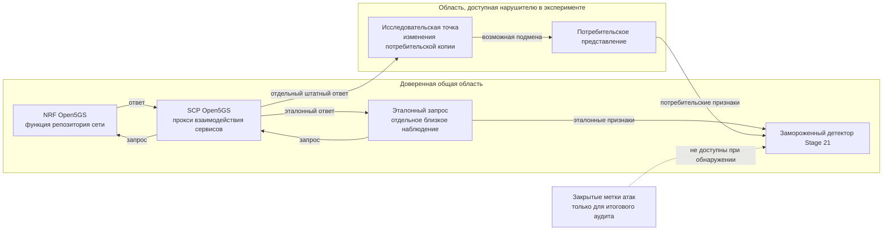
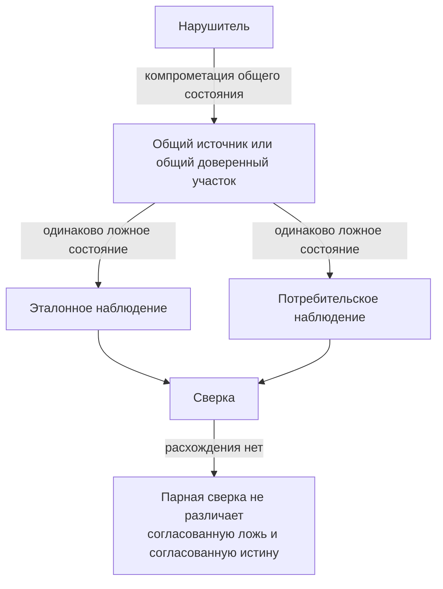

# Формальная модель доверия и нарушителя для Stage 21

Этот документ фиксирует границы утверждений Stage 21 и должен использоваться
как источник для раздела статьи «Модель доверия и нарушителя».

Главный принцип: система не является «оракулом истины». Она обнаруживает
**расхождение между двумя наблюдениями**, если хотя бы одно из наблюдений
формируется вне области контроля нарушителя и если атака изменяет хотя бы одно
из контролируемых представлений данных.

## 1. Два уровня постановки задачи

Необходимо различать целевой метод и фактически выполненную проверку.

### 1.1. Целевая модель распределённого мониторинга

В общей архитектуре контролируемый узел может быть скомпрометирован и способен
формировать ложную отчётность. Для обнаружения такой компрометации требуется
второй канал наблюдения, который формируется **вне области контроля
скомпрометированного узла**.

Иными словами, сравниваются:

- отчётное представление, потенциально формируемое скомпрометированным узлом;
- независимое транзитное или эталонное наблюдение;
- результат их сверки во внешнем доверенном блоке обнаружения.

Эта постановка соответствует общему принципу «ведущий–ведомый»: достоверность
нельзя проверять только данными, полностью формируемыми самим контролируемым
узлом.

### 1.2. Реально проверенная модель Open5GS Stage 21

В живом эксперименте сделано более узкое предположение:

- штатная функция репозитория сети **NRF (Network Repository Function,
  функция репозитория сети)** считается доверенной;
- штатный **SCP (Service Communication Proxy, прокси взаимодействия сервисов)**
  Open5GS считается доверенным и не модифицируется;
- эталонное наблюдение получается отдельным близким по времени запросом через
  настоящий путь SCP→NRF;
- потребительское наблюдение также сначала проходит настоящий путь SCP→NRF;
- только **после** получения штатного ответа исследовательская точка внесения
  отказа может изменить потребительскую копию;
- детектор не контролируется нарушителем;
- закрытые метки атак не доступны детектору и подключаются только после
  завершения слепого обнаружения.

Следовательно, Stage 21 проверяет устойчивость к нарушителю
**потребительской ветви после общего доверенного пути**, а не компрометацию
самого SCP или NRF.

## 2. Диаграмма границ доверия текущего стенда

Схема специально показывает, что два наблюдения **не являются полностью
инфраструктурно независимыми**: они разделяют доверенные NRF и SCP. Их
независимость относится к исследуемой области изменения после SCP.

## 3. Формальная постановка

Пусть:

- \(X_t\) — состояние общего доверенного источника в момент \(t\);
- \(R_t\) — эталонное наблюдение;
- \(C_t\) — потребительское наблюдение;
- \(A_t\) — действие нарушителя на потребительской ветви;
- \(\phi_k(\cdot)\) — одно из контролируемых представлений данных:
  численное, структурное или семантическое;
- \(D_k\) — соответствующее последовательное правило обнаружения.

Для текущего стенда приближённо:

\[
R_t = O_{ref}(X_t), \qquad
C_t = A_t\bigl(O_{cons}(X_{t+\Delta})\bigr),
\]

где \(\Delta\) — малая, но ненулевая разница времени между двумя отдельными
запросами.

Атака является **наблюдаемой** для канала \(k\), если выполняется

\[
\phi_k(R_t) \neq \phi_k(C_t)
\]

на достаточном числе отсчётов и замороженное правило \(D_k\) достигает
условия тревоги.

Из этого следует принципиальное ограничение:

\[
\forall k: phi_k(R_t)=\phi_k(C_t)
\quad\Longrightarrow\quad
	ext{сверка сама по себе не может доказать подмену}.
\]

То есть совпадение двух наблюдений означает согласованность, но не абсолютную
истинность общего состояния.

## 4. Уровни доверия

| Уровень | Что предполагается | Статус |
|---|---|---|
| У0 — чистота оценки | закрытые метки недоступны детектору | экспериментально обеспечено |
| У1 — независимость потребительской ветви | нарушитель меняет только копию после общего SCP→NRF пути | экспериментально проверено |
| У2 — компрометация контролируемого узла | ложная отчётность узла сравнивается с наблюдением, формируемым вне его зоны контроля | целевая модель метода; полностью живым Stage 21 не проверена |
| У3 — византийский многоточечный нарушитель | нарушитель контролирует и отчётность, и эталон/общий источник | вне области утверждений |

## 5. Возможности нарушителя в Stage 21

В рамках выполненного живого эксперимента нарушитель может:

1. изменять строковые значения при сохранении структуры;
2. изменять числовые значения;
3. менять идентификатор сетевой функции;
4. менять статус сетевой функции;
5. удалять структурные листья;
6. удалять профиль целиком;
7. действовать разреженно или постоянно;
8. выбирать разные моменты воздействия в разных независимых запусках.

Нарушитель в текущей проверке **не может**:

1. модифицировать бинарный код NRF;
2. модифицировать бинарный код SCP;
3. изменять эталонное наблюдение после доверенной точки;
4. изменять состояние детектора;
5. видеть закрытые метки в момент обнаружения;
6. одновременно компрометировать общий источник и обе ветви наблюдения.

## 6. Матрица атак и границ применимости

| Сценарий | Эталон остаётся независимым? | Меняется контролируемое представление? | Вывод |
|---|---:|---:|---|
| Подмена значения только в потребительской ветви | да | да | проверено; Stage 21 обнаруживает |
| Разреженное удаление поля | да | да | проверено |
| Постоянное удаление профиля | да | да | проверено |
| Ложный отчёт скомпрометированного узла при внешнем транзитном наблюдении | предполагается | зависит от признака | соответствует целевой модели, но не является прямым живым тестом Stage 21 |
| Компрометация общего NRF, одинаково влияющая на обе ветви | нет | может не меняться | не обнаруживается одной парной сверкой |
| Компрометация общего SCP до разделения наблюдений | нет | может не меняться | текущим стендом не проверено |
| Компрометация эталонного сборщика | нет | неопределённо | вне области модели |
| Сговор потребительской и эталонной точек | нет | может не меняться | вне области модели |
| Перестановка идентификаторов между профилями с сохранением мультимножества значений по пути | да | нет для текущего семантического представления | известная граница; полнота 0 |
| Изменение только нестабильного семантического пути, исключённого при прогреве | да | семантический канал может не видеть | возможная граница |
| Отказ в обслуживании или произвольная задержка транспорта | частично | иной класс сигнала | не является основной проверкой Stage 21 |

## 7. Общий отказ: синхронная ложь в двух каналах

Наиболее важный отрицательный сценарий — общий режим отказа.

Поэтому формулировка «независимое наблюдение» должна означать независимость
**от зоны контроля предполагаемого нарушителя**, а не просто наличие второго
программного запроса.

## 8. Известная представительная граница Stage 21

Семантический канал нормализует индексы массивов и сравнивает мультимножества
значений по пути. Это позволяет устойчиво обнаруживать подмену значения, но
теряет отношение «какое значение принадлежало какому конкретному объекту».

Поэтому заранее объявленный сценарий перестановки идентификаторов между двумя
профилями сохраняет мультимножество значений и остаётся невидимым.

Это не ошибка статистической мощности: такая атака является **инвариантом
текущего представления**. Для её обнаружения потребуется отдельный реляционный
канал, связывающий идентификатор объекта с другими атрибутами профиля.

## 9. Криптографические границы

SHA-256 в семантическом канале используется только как детерминированная метка
равенства значения.

Он:

- не является кодом аутентификации сообщения;
- не доказывает происхождение значения;
- не защищает от подмены источника;
- не даёт заявленной конфиденциальности для значений с малой энтропией;
- не заменяет взаимную аутентификацию транспортного уровня.

Следовательно, криптографическая защита канала и логическая сверка
достоверности решают разные задачи.

## 10. Что именно разрешено утверждать по результатам Stage 21

Корректное утверждение:

> На штатном пути Open5GS SCP→NRF при доверенных неизменённых NRF и SCP,
> недоступном нарушителю эталонном наблюдении и изменяемой потребительской
> ветви после SCP многоканальная последовательная сверка обнаружила все
> 1536 основных атакующих эпизодов в 128 независимых запусках, при этом
> наблюдавшихся ложных тревог на 10 752 чистых отсчётах не было.

Некорректные расширения этого утверждения:

- «доказано обнаружение компрометации штатного SCP»;
- «доказано обнаружение компрометации NRF»;
- «доказана истинность данных, если два наблюдения совпадают»;
- «метод устойчив к сговору двух контролируемых точек»;
- «метод обнаруживает любые семантические изменения»;
- «SHA-256 метки обеспечивают аутентификацию или конфиденциальность».

## 11. Формулировка для статьи

Рекомендуемая формулировка раздела:

> Модель нарушителя предполагает возможность произвольного изменения
> потребительского представления контролируемых служебных данных, включая
> разреженные и постоянные подмены значений и структуры, при условии, что
> эталонное наблюдение и блок обнаружения остаются вне области контроля
> нарушителя. В экспериментальном стенде это условие реализовано в более узкой
> форме: штатные функции NRF и SCP Open5GS считаются доверенными, оба
> наблюдения проходят через настоящий путь SCP→NRF, а исследовательская
> модификация применяется только к потребительской копии после прохождения SCP.
> Поэтому эксперимент проверяет обнаружение нарушения целостности между
> ветвями наблюдения, но не моделирует компрометацию самого SCP, NRF либо
> согласованную подмену общего источника. Совпадение эталонного и
> потребительского представлений трактуется как отсутствие наблюдаемого
> рассогласования, а не как доказательство абсолютной истинности данных.

## 12. Связь с воспроизводимостью

Машиночитаемая версия модели находится в
`stage21/trust_model.json`. Она должна изменяться только как отдельное
научное решение; изменения модели доверия не должны задним числом менять
интерпретацию уже завершённых оценочных блоков 8401–8864.
